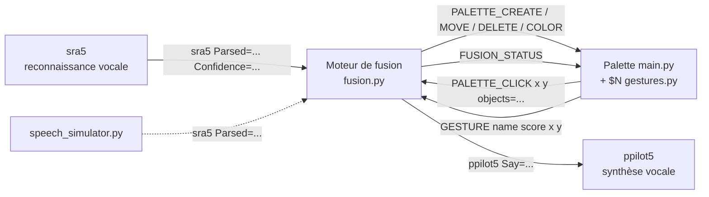
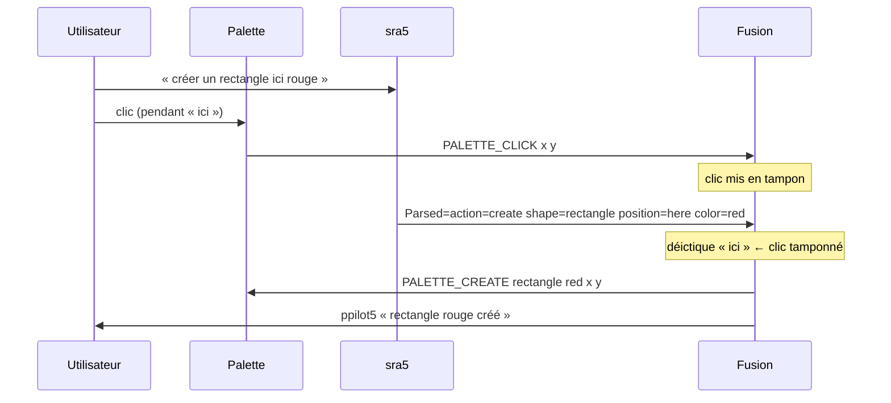
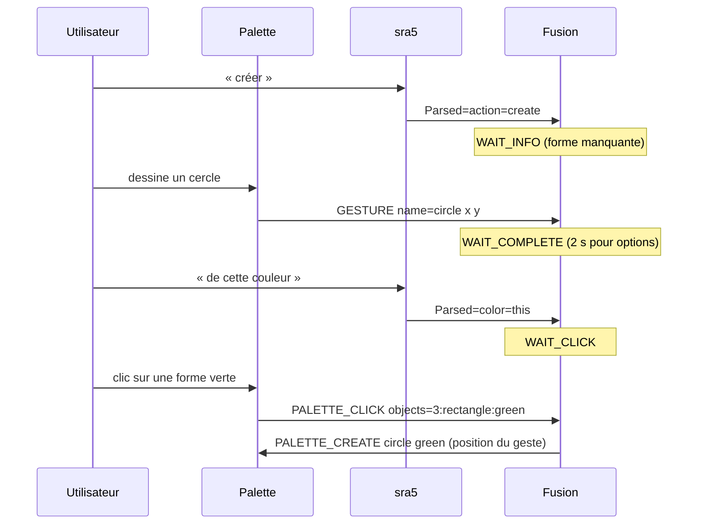
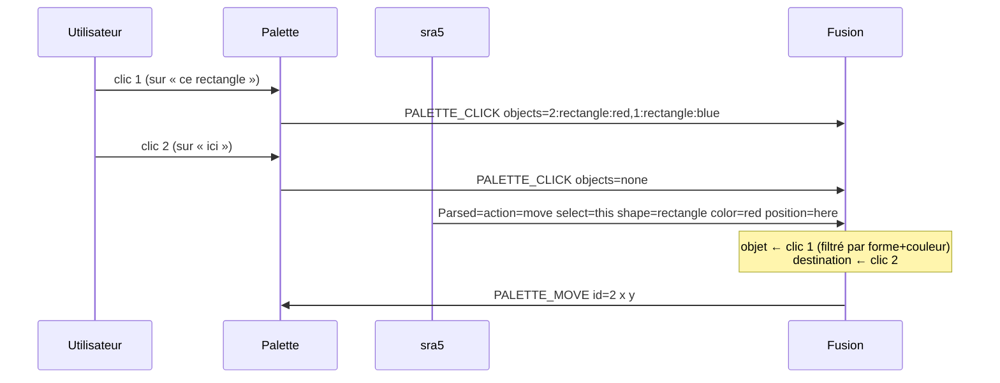
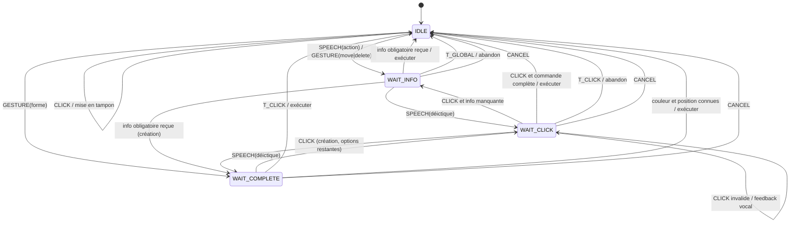
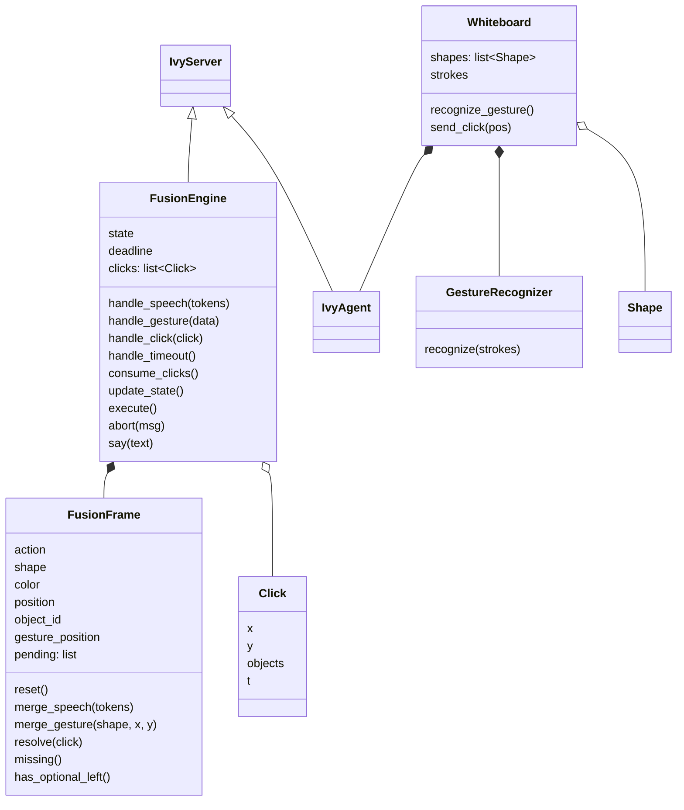

# Moteur de fusion multimodale — Rapport

> Squelette à compléter (captures d'écran, analyse, conclusion).

## 1. Introduction

Objectif : palette de dessin sans bouton, pilotée par la parole (sra5), des gestes ($N) dessinés sur la palette et le pointage souris, en s'inspirant de *Put That There* (Bolt, 1980).

## 2. Architecture



### Protocole Ivy

| Émetteur | Message | Rôle |
|---|---|---|
| sra5 | `sra5 Parsed=action=create shape=circle color=red position=here Confidence=0,85 NP=1 Num_A=0` | résultat de reconnaissance |
| Palette | `PALETTE_CLICK x=<x> y=<y> objects=<id:forme:couleur,...\|none>` | pointage (objets sous le clic, du plus haut au plus bas) |
| Palette | `GESTURE name=<rectangle\|circle\|triangle\|diamond\|move\|delete> score=<s> x=<cx> y=<cy>` | geste reconnu (centre de la boîte englobante) |
| Fusion | `PALETTE_CREATE shape= color= x= y=` / `PALETTE_MOVE id= x= y=` / `PALETTE_DELETE id=` / `PALETTE_COLOR id= color=` | commandes |
| Fusion | `FUSION_STATUS state=<état> text=<résumé>` | retour visuel |
| Fusion | `ppilot5 Say=<texte>` | retour vocal |
| Palette | `PALETTE_CREATED / MOVED / DELETED / COLORED ...` | accusés d'exécution |

## 3. Grammaires

### Parole (`sra5/sra5/grammaire_parole.grxml`)

- Création : *créer / dessiner / tracer* [forme] [couleur \| « de cette couleur »] [« ici » \| « là »] (ordre couleur/position libre)
- Déplacement : *déplacer / bouger* [« cet objet » \| « ce » forme] [couleur] [« ici »]
- Suppression : *supprimer / effacer* [désignation] [couleur]
- Coloriage : *colorier / peindre* [désignation] [en] couleur \| « de cette couleur »
- Fragments isolés : forme, couleur, « ici », « cet objet », « ce rectangle », « annuler »

### Gestes (`gestures.py`, $N)

| Geste | Sens |
|---|---|
| rectangle, cercle, triangle, losange | forme à créer |
| flèche (2 traits, 4 directions) | action « déplacer » |
| croix X (2 traits) | action « supprimer » |

Distinction clic / geste sur la palette : un appui-relâché dont le tracé fait moins de 6 px est un **clic** ; sinon c'est un **trait**. Le geste (éventuellement multi-traits) est reconnu 0,6 s après le dernier trait.

## 4. Chronogrammes

Fenêtre d'association clic ↔ parole : **2 s** ; délai d'inactivité d'une commande incomplète : **5 s**.

### « Créer un rectangle ici rouge » + clic



### « Créer » + geste + « de cette couleur » + clic



### « Déplacer ce rectangle rouge ici » + 2 clics



<!-- TODO : ajouter les variantes (clic avant / après la parole, geste flèche + « ce rectangle » + « ici »). -->

## 5. Contrôleur de dialogue

### Événements

| Événement | Source |
|---|---|
| `SPEECH(action?, forme?, couleur?, déictiques…)` | sra5 |
| `GESTURE(forme \| move \| delete, x, y)` | palette |
| `CLICK(x, y, objets)` | palette |
| `T_CLICK` (2 s) | timer |
| `T_GLOBAL` (5 s) | timer |
| `CANCEL` (« annuler ») | sra5 |

### Machine à états



Une nouvelle action (parole ou geste) en cours de commande : la commande courante est exécutée si elle est en `WAIT_COMPLETE`, sinon abandonnée.

### Matrice états / événements

| État \ Événement | SPEECH(action) | SPEECH(fragment) | GESTURE(forme) | GESTURE(move/delete) | CLICK | T_CLICK | T_GLOBAL | CANCEL |
|---|---|---|---|---|---|---|---|---|
| IDLE | nouvelle commande | ignoré | création | nouvelle commande | tampon | – | – | – |
| WAIT_INFO | abandon + nouvelle | fusion | fusion forme (si création) | abandon + nouvelle | tampon | – | abandon | abandon |
| WAIT_CLICK | abandon + nouvelle | fusion | fusion forme (si création) | abandon + nouvelle | résolution déictique | abandon | – | abandon |
| WAIT_COMPLETE | exécuter + nouvelle | fusion | exécuter + nouvelle création | exécuter + nouvelle | tampon | exécuter | – | abandon |

## 6. Conception logicielle



`FusionFrame` est réinitialisée après chaque exécution, abandon ou annulation.

## 7. Exemples d'utilisation

<!-- TODO : captures d'écran -->

## 8. Limites et perspectives

<!-- TODO -->

## 9. Mode d'emploi

```
pip install -r requirements.txt
launch.bat        (sra5 réel)
launch.bat sim    (simulateur de parole)
```